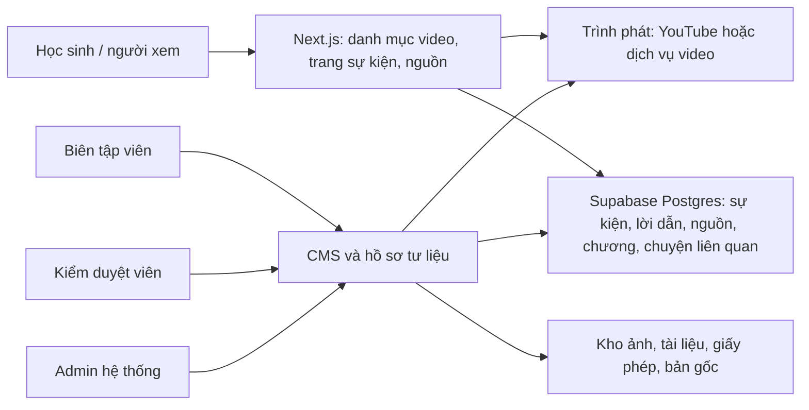

# Nghiên cứu phương án kể chuyện lịch sử bằng video

**Trạng thái:** Đề xuất để thảo luận, ngày 22/09/2026. Chưa thay thế phạm vi MVP và đặc tả use case hiện có.

## 1. Bài toán và giới hạn quan sát

Định hướng mới do chủ dự án nêu: mỗi sự kiện lịch sử Việt Nam lớp 12 có một video kể chuyện làm nội dung chính. Người xem đọc rất ít trên màn hình, có thể mở nguồn và thông tin chi tiết ở bên dưới. Mỗi sự kiện có thể nối với mẩu chuyện bên lề hoặc lời kể của nhân chứng/cựu chiến binh. Mục tiêu nội dung vẫn là đáng tin cậy và có thể kiểm chứng.

Video tham chiếu: [Cuộc đời và sự nghiệp cách mạng của Chủ tịch Hồ Chí Minh](https://youtu.be/UIutoCqw01Y), kênh Hội Liên hiệp Phụ nữ Thành phố Hồ Chí Minh. Đã phát hết video trên cửa sổ Chrome do chủ dự án mở sau khi trình phát ở phiên Chrome riêng bị lỗi. Công cụ quan sát được hình ảnh trên màn hình nhưng không thu nhận âm thanh; các nhận xét dưới đây chỉ nói về nhịp hình ảnh và cấu trúc thấy được, **không** thẩm định lời thuyết minh hay tính đúng sai của các nhận định lịch sử.

Video là **phim tư liệu kể theo niên đại**: mở bằng quả địa cầu, chuyển qua ảnh/phim và văn bản lưu trữ, minh họa chuyển động, một cảnh bản đồ phục vụ bước chuyển địa lý, rồi các mốc năm nổi bật trên nền đỏ/trắng. Phần cuối quay về tài liệu và các dòng chữ kết lại câu chuyện. Video có những cảnh tái dựng bằng đồ họa; sản phẩm của dự án cần ghi rõ cảnh nào là ảnh/phim gốc và cảnh nào là minh họa. Đây là nhận xét về hình thức quan sát được, không phải xác nhận các dữ kiện được kể. Video mẫu kể cả một cuộc đời, nên độ dài 14 phút 29 giây không thể tự động áp cho mỗi sự kiện đơn lẻ.

Đề xuất này thay đổi đáng kể [`MVP-SCOPE.md`](./MVP-SCOPE.md) và [`USE-CASES.md`](./USE-CASES.md): hai tài liệu ấy hiện yêu cầu timeline và bản đồ là luồng chính, còn video chưa thuộc phạm vi. Chỉ cập nhật chúng sau khi thống nhất định hướng.

## 2. Trải nghiệm người học đề xuất

Trang sự kiện lấy **video do dự án biên tập và thẩm định** làm tâm điểm:

1. Ảnh đại diện, tiêu đề, thời lượng và nút phát do người dùng chủ động bấm; có liên kết mở video trên nền tảng gốc khi trình nhúng lỗi.
2. Video kể theo các chương ngắn; lời dẫn, ảnh tư liệu, hoạt họa, tài liệu gốc và bản đồ được chọn theo điều cần giải thích. Giữ chữ trong khung hình ở mức ngày, tên, địa điểm hoặc một ý then chốt.
3. Ngay dưới video có tóm tắt ngắn, các chương, chú thích nguồn theo mốc thời gian và phần “Tìm hiểu thêm”. Người muốn kiểm chứng mở được nguồn cho nhận định cụ thể thay vì chỉ thấy một danh sách tham khảo chung.
4. “Chuyện bên lề” dẫn đến đoạn phỏng vấn, ký ức hoặc câu chuyện liên quan, nêu rõ người kể, thời điểm ghi nhận, nguồn gốc và quan hệ với sự kiện. Tách lời chứng cá nhân khỏi lời dẫn đã tổng hợp và thẩm định.
5. Phụ đề tiếng Việt chính xác, bản chép lời và cách hiểu nội dung hình ảnh quan trọng luôn có sẵn theo lựa chọn của người xem. Thiết kế này giúp cả người không thể nghe, đang xem không bật tiếng hoặc muốn tra cứu chi tiết. [WCAG 2.2 về phụ đề](https://www.w3.org/WAI/WCAG22/Understanding/captions-prerecorded.html), [hướng dẫn transcript của W3C](https://www.w3.org/WAI/media/av/transcripts/).

Một kịch bản sự kiện có thể đi theo nhịp: **câu hỏi mở → bối cảnh → lựa chọn và diễn biến → hệ quả → điều còn cần phân biệt/kiểm chứng**. Dạng cảnh phù hợp gồm tài liệu gốc được phóng to, ảnh/phim lưu trữ có chú thích, minh họa được gắn nhãn, lời kể nhân chứng và bản đồ khi không gian thật sự có vai trò. Đây là khuôn biên tập để thử nghiệm, không ép tất cả sự kiện vào cùng một cách kể.

**Vai trò bản đồ:** dùng khi vị trí hoặc hướng di chuyển giải thích nguyên nhân, diễn biến hay kết quả; khi ấy nó là một cảnh trong video hoặc hình tương tác bổ sung. Với sự kiện ít phụ thuộc không gian, ảnh, văn bản gốc, hiện vật hay chân dung hữu ích hơn. Có thể giữ địa điểm có nguồn trong dữ liệu nhưng quyết định có cần trang bản đồ riêng sau thử nghiệm với người học. Timeline ngắn vẫn hữu ích để chọn video theo tiến trình, không phải nơi buộc người học đọc toàn bộ nội dung.

Lời kể cựu chiến binh chỉ phù hợp các giai đoạn còn nhân chứng sống hoặc đã để lại bản ghi. Với sự kiện xa hơn, chuyện bên lề có thể là thư từ, nhật ký, hồi ký hoặc câu chuyện về hiện vật, miễn có xuất xứ và đủ quyền sử dụng.

### Thời lượng cần kiểm nghiệm

Video tham chiếu dài khoảng 14 phút 29 giây theo trình phát quan sát được. Nếu 25–35 video cùng độ dài, tổng thành phẩm khoảng **6 giờ 02 phút đến 8 giờ 27 phút**. Đây là phép tính thời lượng, chưa phải ước lượng công sức sản xuất. Nghiên cứu về video học trực tuyến cho thấy video ngắn hơn có xu hướng được xem lâu hơn, nhưng dữ liệu là khóa MOOC, không trực tiếp đo học sinh Việt Nam hoặc phim lịch sử. Vì vậy nên làm một video mẫu và kiểm tra người học trước khi ấn định độ dài. [Guo, Kim & Rubin, L@S 2014](https://doi.org/10.1145/2556325.2566239).

Phương án khởi đầu để thử: câu chuyện chính 4–6 phút cho một sự kiện vừa; sự kiện nhiều lớp có thể chia thành các chương hoặc video dài hơn; lời kể nhân chứng là phần bổ sung. Đây là giả thuyết thiết kế, **không phải giới hạn đã được duyệt**.

## 3. Kiến trúc hệ thống

Repo hiện có Next.js App Router, React, TypeScript, Tailwind và các migration Supabase **đang nằm ở cây làm việc local** cho sự kiện, nhân vật, địa điểm, nguồn và quy trình nhân sự. Có thể tiếp tục dùng nền này sau khi kiểm chứng migration; đây chưa phải hệ thống CMS đã triển khai. Chưa cần AI, vector database, 3D hay engine game để làm 25–35 sự kiện. Tìm kiếm/lọc theo chủ đề, niên đại, tên và bản chép lời có thể bắt đầu từ dữ liệu đã xuất bản trong Postgres.

Trang công khai có thể render tiêu đề, tóm tắt và nguồn trên server; chỉ tải trình phát khi người dùng bấm ảnh đại diện để giảm dữ liệu và tránh tự phát. URL của mỗi sự kiện/chương có thể chia sẻ. Khi video lỗi hoặc bị gỡ, trang vẫn hiển thị tóm tắt, nguồn và bản chép lời, cùng thông báo rõ ràng về trạng thái media. Khu CMS kiểm tra quyền trên server và trong RLS, còn hồ sơ đồng ý công bố/bản gốc không nằm trong dữ liệu công khai.

### Dữ liệu cần thêm so với schema hiện có

| Nhóm | Nội dung tối thiểu | Vì sao |
| --- | --- | --- |
| Video chính | Sự kiện, video ID/nhà cung cấp, phiên bản, thời lượng, ảnh đại diện, trạng thái, phụ đề/bản chép lời | Mỗi sự kiện có video chính được kiểm duyệt; sửa sai có phiên bản |
| Phân đoạn/kịch bản | Mốc bắt đầu/kết thúc, lời dẫn, mô tả cảnh, các nhận định lịch sử và nguồn tương ứng | Kiểm chứng được câu nói hoặc cảnh cụ thể |
| Hồ sơ nhận định | Nội dung, mức `verified`/`approximate`/`disputed`/`editorial`, nguồn, ghi chú giới hạn | Không biến diễn giải hoặc ký ức thành dữ kiện chắc chắn |
| Tư liệu truyền thông | Ảnh/audio/video/tài liệu, xuất xứ, chủ sở hữu, điều kiện sử dụng, credit, giấy phép hoặc văn bản đồng ý | Có nguồn lịch sử chưa đồng nghĩa có quyền dùng hình/âm thanh |
| Chuyện bên lề / nhân chứng | Loại chuyện, sự kiện liên quan, người kể, ngày phỏng vấn, đoạn gốc, bản chép lời, tình trạng đồng ý công bố | Giữ ngữ cảnh lời kể và khả năng gỡ/chỉnh theo quyền đã cấp |
| Lịch sử kiểm duyệt | Người biên tập, người duyệt, lý do trả lại, ngày công bố, phiên bản | Truy trách nhiệm và sửa sai công khai |

Trong pilot một sự kiện, hồ sơ nhận định và storyboard có thể quản lý trong bảng biên tập có cấu trúc trước khi xây đủ giao diện CMS. Khi quy trình ổn định mới chuẩn hóa thành các bảng Postgres. Schema hiện tại chỉ có `media_assets` cho `image`/`document` và liên kết nguồn ở cấp sự kiện; chưa đủ để xuất bản video kèm bằng chứng theo lời dẫn.

### Quy trình nội dung theo bốn vai trò đã xác nhận

1. **Biên tập viên:** chọn mục tiêu học tập và sự kiện, lập danh mục nguồn và quyền sử dụng, viết kịch bản gắn từng nhận định với nguồn, dựng storyboard, thu lời dẫn/phụ đề và tạo bản nháp video.
2. **Kiểm duyệt viên:** đối chiếu nhận định và hình minh họa, đánh dấu chỗ chỉ là tái dựng hoặc còn tranh luận, kiểm tra giấy phép, phụ đề và ngữ cảnh nhân chứng; trả sửa hoặc công bố một phiên bản cụ thể.
3. **Admin hệ thống:** quản lý tài khoản, quyền và cấu hình; không thay thế bước thẩm định lịch sử chỉ vì có quyền hệ thống.
4. **Người dùng:** xem video đã công bố, xem nguồn, bản chép lời và chuyện liên quan; có đường báo lỗi nội dung đơn giản để nhóm biên tập xử lý.

Đối với lời kể nhân chứng, cần sự đồng ý có hiểu biết, ghi rõ phạm vi công bố và cho người kể cơ hội duyệt trước khi phát hành; xác minh riêng những chi tiết được dùng như sự kiện khách quan. Đây là nguyên tắc nghề nghiệp của [Oral History Association](https://oralhistory.org/best-practices/). Tránh cắt một câu khiến lời kể đổi nghĩa; lưu bản gốc có kiểm soát và dẫn người xem đến ngữ cảnh đầy đủ khi được phép.

### Tác động tới đặc tả use case hiện có

| Use case hiện tại | Điều chỉnh nếu duyệt hướng video |
| --- | --- |
| UC00/UC01/UC03 | Trang vào, dòng thời gian và tìm kiếm dẫn tới video sự kiện; lọc còn theo chủ đề/giai đoạn |
| UC02 | Kiểm nghiệm nhu cầu trang bản đồ riêng; tối thiểu giữ bản đồ trong các cảnh cần giải thích không gian |
| UC04 | Xem video chính, chương, nguồn theo mốc, bản chép lời và chuyện liên quan |
| UC07/UC09 | Biên tập kịch bản, video, nguồn theo nhận định, tư liệu và quyền sử dụng |
| UC10 | Duyệt bản video cụ thể cùng nội dung và quyền tư liệu trước khi công bố |
| Use case mới cần đặc tả | Xem chuyện nhân chứng; báo sai sót và công bố phiên bản sửa |

Bốn actor đăng nhập/công khai vẫn là **người dùng, biên tập viên, kiểm duyệt viên và admin hệ thống**. Người kể chuyện và chủ sở hữu tư liệu là đối tác của quy trình nội dung, không mặc nhiên phải có tài khoản ứng dụng.

## 4. Thu thập nhiều nguồn và quyền sử dụng

**Hai sổ theo dõi tách biệt:** (a) nguồn chứng minh dữ kiện, (b) quyền dùng ảnh, âm thanh, phim, giọng nói. Một trang bảo tàng có thể giúp xác minh một mốc lịch sử nhưng ảnh trên đó vẫn cần xem điều kiện sử dụng riêng.

Thứ tự tìm nguồn: chương trình/sách giáo khoa để lập danh mục mục tiêu; bảo tàng, lưu trữ và thư viện cho tư liệu gốc; công trình học thuật/ấn phẩm đã xuất bản để đối chiếu; phỏng vấn nhân chứng để bổ sung góc nhìn và đời sống cá nhân. [Chương trình môn Lịch sử của Bộ GD&ĐT](https://moet.gov.vn/content/vanban/Lists/VBPQ/Attachments/1483/vbhn-chuong-trinh-mon-lich-su.pdf) có các hình thức học qua phim tư liệu/bảo tàng. [Bảo tàng Lịch sử Quốc gia](https://baotanglichsu.vn/vi) có các mục hiện vật, tư liệu và thư viện video; cần liên hệ đơn vị sở hữu để biết khả năng truy cập/sử dụng tệp gốc.

Các điểm bắt đầu cụ thể cho sổ nguồn là [Cổng lưu trữ số quốc gia](https://dichvucong.luutru.gov.vn/) và [mục lục tài liệu lưu trữ Việt–Pháp](https://vietphap.luutru.gov.vn/tructuyen/ttlt.aspx?idCQ=2), bên cạnh bảo tàng, thư viện và tác giả/nhân chứng phù hợp từng giai đoạn. Những nơi này là **đầu mối tra cứu**, không phải cam kết mọi file đều mở tải hoặc được phép tái sử dụng.

Mỗi mục trong bảng kiểm kê nguồn nên có: sự kiện liên quan, nhận định hỗ trợ, tên tài liệu, tác giả/cơ quan, URL/ký hiệu lưu trữ, trang hoặc mốc thời gian, ngày truy cập, độ tin cậy/điểm cần đối chiếu, loại media, chủ quyền, giấy phép, người liên hệ và trạng thái cho phép sử dụng. Không tự động thu thập hàng loạt rồi xem mọi nội dung tìm được là có thể tái sử dụng.

| Tình trạng tư liệu | Cách đưa vào sản phẩm |
| --- | --- |
| Nhóm tự tạo và có văn bản đồng ý/phạm vi sử dụng rõ | Có thể dựng vào video và lưu bản gốc theo quyền đã cấp |
| Video của bên khác cho phép nhúng | Nhúng/liên kết như chuyện liên quan, giữ tên kênh và đường về nguồn |
| Bài viết/ảnh/phim chỉ xem công khai, chưa rõ quyền tái sử dụng | Dùng làm đầu mối nghiên cứu/trích dẫn trong phạm vi phù hợp; chưa đưa hình/âm thanh vào video của dự án |
| Nguồn kể còn tranh luận hoặc là hồi ức cá nhân | Nêu tư cách nguồn và mức chắc chắn; kiểm chứng riêng các chi tiết dùng trong lời dẫn |

## 5. Phân phối video và chi phí kỹ thuật

| Cách | Phù hợp | Giới hạn cần chấp nhận |
| --- | --- | --- |
| **YouTube cho video do dự án sở hữu, nhúng vào trang** | Pilot và ngân sách hạ tầng thấp; dùng trình phát, phụ đề và kênh riêng | Phụ thuộc YouTube, giao diện/quảng cáo và khả năng nhúng; cần tuân thủ chính sách trình phát, có liên kết mở ở YouTube khi nhúng lỗi. [IFrame API](https://developers.google.com/youtube/iframe_api_reference), [chính sách nhà phát triển](https://developers.google.com/youtube/terms/developer-policies-guide) |
| **Nhúng video sẵn có của bảo tàng/nhân chứng** | Chuyện liên quan khi chủ sở hữu cho phép nhúng | Không sao chép, tải hoặc cắt dựng lại video chỉ vì nó đang công khai; phải ghi nguồn và xử lý khi video bị gỡ/khóa nhúng. [YouTube copyright](https://support.google.com/youtube/answer/2797466) |
| **Dịch vụ video chuyên dụng, ví dụ Cloudflare Stream** | Khi cần kiểm soát phát, branding hoặc dữ liệu hơn và đã có quyền tệp gốc | Có chi phí theo phút lưu/phát. Tại thời điểm nghiên cứu, Cloudflare công bố 5 USD/1.000 phút lưu/tháng và 1 USD/1.000 phút phát; kiểm tra giá khi ra quyết định. [Cloudflare Stream pricing](https://developers.cloudflare.com/stream/pricing/) |

Supabase Postgres chỉ lưu metadata, kịch bản, nguồn, quyền và trạng thái; không lưu file MP4 trong bảng. Supabase Storage có thể chứa ảnh/tài liệu và tệp làm việc phù hợp, nhưng gói Free giới hạn 50 MB mỗi tệp theo [tài liệu hiện tại](https://supabase.com/docs/guides/storage/uploads/file-limits). Với video chính, dịch vụ phát chuyên dụng hoặc YouTube có thể đơn giản hơn về mã hóa và phân phối. Bảng có nội dung chưa công bố hoặc thông tin nhân chứng phải dùng quyền server và RLS; tham khảo [hướng dẫn RLS của Supabase](https://supabase.com/docs/guides/database/postgres/row-level-security).

## 6. Độ khả thi và phép thử quyết định

**Khả thi về kỹ thuật:** cao cho trang danh mục/video/nguồn và CMS cơ bản trên stack hiện có. **Nút thắt thực tế:** biên tập 25–35 kịch bản đúng, tìm tư liệu được cấp quyền, sản xuất video và kiểm duyệt, đặc biệt nếu mọi video dài và giàu hoạt họa. Chưa thể đưa lịch/cost đáng tin cậy cho cả kho video khi chưa biết số người, kinh phí, mức đồ họa và tình trạng sẵn có của tư liệu.

| Phần việc | Đánh giá sơ bộ | Bằng chứng quyết định |
| --- | --- | --- |
| Web phát video, danh mục và trang sự kiện | Khả thi cao với nền hiện có | Pilot chạy được trên mobile, bàn phím, mạng yếu và khi trình nhúng lỗi |
| Liên kết lời dẫn với nguồn và kiểm duyệt | Khả thi, cần thiết kế quy trình biên tập | Kiểm duyệt viên lần được từng nhận định quan trọng về tài liệu gốc |
| Sản xuất 25–35 video cùng mức đồ họa phim mẫu | Rủi ro tiến độ cao nếu nhóm nhỏ | Đo giờ nghiên cứu, dựng, chỉnh sửa và duyệt của video mẫu |
| Tư liệu ảnh/phim và nhân chứng | Rủi ro quyền sử dụng và tiếp cận | Có xác nhận quyền, bản gốc, và danh mục nguồn thực tế cho từng sự kiện |

Để ước lượng sau pilot, lấy **giờ làm thực tế của một video đại diện** nhân với 25–35 video, rồi cộng thời gian xây nền web và các khoảng chờ xin quyền. Ví dụ minh họa thuần túy: nếu pilot cần 20/40/80 giờ sản xuất cho một video, kho 25–35 video cần lần lượt 500–700 / 1.000–1.400 / 2.000–2.800 giờ công sản xuất. Đây **không** phải báo giá hay dự đoán; nó cho thấy chất lượng hoạt họa và mức sẵn có của nguồn sẽ quyết định tiến độ hơn việc nhúng trình phát video.

Nên chạy một pilot trọn quy trình trước khi nhân rộng:

1. Chọn **một** sự kiện có nguồn phong phú và có thể xin quyền dùng ít nhất vài tư liệu hình/âm thanh.
2. Viết hồ sơ nhận định và kịch bản; mỗi câu mang thông tin lịch sử có nguồn hoặc nhãn diễn giải rõ. Lấy giấy phép/đồng ý đối với mọi tài nguyên dùng trong bản cuối.
3. Dựng một video đại diện chất lượng mong muốn, phụ đề, bản chép lời, chương và trang nguồn. Nếu có lời kể nhân chứng, thẩm định và lưu đồng ý công bố riêng.
4. Cho 5–8 học sinh lớp 12 xem thử như một kiểm tra khám phá, không coi mẫu nhỏ là bằng chứng thống kê. Quan sát họ hiểu gì, xem tới đâu, có tìm được nguồn, và hình/nhạc có khiến họ hiểu sai điều gì không.
5. Ghi thời gian từng công đoạn, số tư liệu xin được quyền, thời gian duyệt và chi phí thực tế. Nhân lên 25–35 sự kiện theo hai mức chất lượng: video thường và video trọng điểm.

**Điều kiện đạt của pilot:** video phát được trên di động và có phương án khi trình phát lỗi; lời dẫn được truy về nguồn; không dùng tài nguyên thiếu quyền; phụ đề/bản chép lời chính xác; nhân chứng được trình bày đúng tư cách; học sinh tìm được mốc và ý chính; biên tập viên và kiểm duyệt viên hoàn thành quy trình mà không sửa trực tiếp dữ liệu công khai.

## 7. Quyết định còn mở

1. Mỗi sự kiện bắt buộc một phim hoàn chỉnh dài tương đương video tham chiếu, hay chấp nhận video chính ngắn kèm chuyện bên lề dài hơn?
2. Nhóm làm dự án, thời hạn và ngân sách sản xuất video gồm những ai/bao nhiêu?
3. Tư liệu nhân chứng sẽ do nhóm tự phỏng vấn, xin phép dùng bản có sẵn, hay cả hai?
4. Có giữ trang bản đồ riêng không, sau khi xem học sinh có thật sự dùng nó để hiểu chuỗi sự kiện?
5. Nền tảng phát video ban đầu: YouTube của dự án hay một dịch vụ có trả phí?

Khi các điểm này được chốt và video tham chiếu được xem đầy đủ, cập nhật `MVP-SCOPE.md`, use case, schema và kế hoạch triển khai theo hướng đã duyệt.
