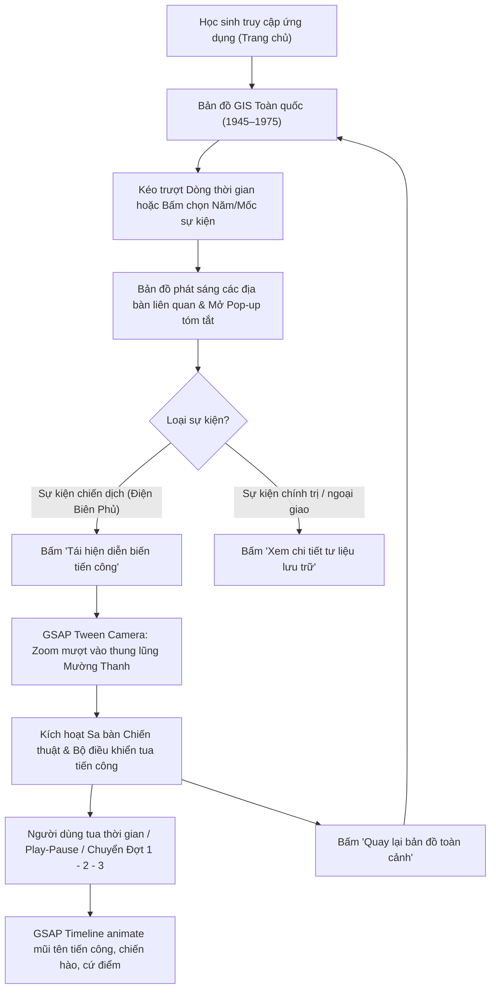

# Đặc tả Thiết kế: Bản đồ GIS Lịch sử, Dòng thời gian & Diễn biến Chiến dịch GSAP

**Ngày:** 2026-09-25  
**Trạng thái:** Chờ người dùng duyệt (Pending User Review)  
**Tài liệu tham chiếu:** `AGENTS.md`, `docs/product/MVP-SCOPE.md`, `docs/product/USE-CASES.md`  

---

## 1. Mục tiêu & Bối cảnh

### 1.1. Bối cảnh
Giao diện hiện tại của dự án chia nhỏ các phần thành các thẻ nội dung dạng trang tĩnh (Landing Hero, Discovery Paths, Recent Story Rows) và các trang route rời rạc (`/dong-thoi-gian`, `/dia-diem`). Trải nghiệm này chưa mang lại cảm giác trực quan về mặt không gian và thời gian cho học sinh lớp 12 khi học lịch sử kháng chiến Việt Nam (1945–1975).

### 1.2. Mục tiêu
Thiết kế lại toàn diện giao diện trung tâm thành một **Nền tảng Khám phá Không - Thời gian Tương tác (Interactive GIS Map & Spatiotemporal Experience)**:
1. **Bản đồ GIS Vector toàn màn hình**: Hiển thị lãnh thổ Việt Nam với đầy đủ chủ quyền, địa danh lịch sử được ánh xạ trực tiếp từ tọa độ địa lý thực (`places.json`).
2. **Dòng thời gian toàn cảnh 1945–1975 (Panoramic Timeline Bar)**: Thanh điều khiển trực quan phân kỳ 2 giai đoạn (1945–1954 và 1954–1975), làm nổi bật các mốc sự kiện tiêu biểu.
3. **Pop-up Thẻ bài Tóm tắt Lịch sử**: Xuất hiện khi chọn sự kiện, hiển thị hình ảnh tư liệu, trích dẫn khảo chứng, và nút kích hoạt diễn biến trận đánh.
4. **Trình diễn biến tiến công chiến dịch bằng GSAP (Tactical Battle Playback)**: Trải nghiệm sa bàn chiến thuật (với trọng tâm là Chiến dịch Điện Biên Phủ 1954), cho phép người dùng tua thời gian, theo dõi các mũi tiến công vector di chuyển, các cứ điểm bị tiêu diệt qua 3 đợt công kích.

---

## 2. Kiến trúc Hệ thống & Luồng Tương tác

### 2.1. Sơ đồ Luồng Trải nghiệm Người dùng



### 2.2. Phân rã Component & Module

```
src/
├── app/
│   ├── page.tsx                           # Giao diện chính chứa InteractiveMapStage
│   └── globals.css                        # Style nền, biến màu thư tịch, animation utility
├── features/
│   ├── map/
│   │   ├── InteractiveMapStage.tsx        # Container chính điều phối Canvas, Popup, Timeline, Battle Player
│   │   ├── VietnamGisMapSvg.tsx           # Vector SVG địa lý Việt Nam + camera viewBox tweening
│   │   ├── MapMarkerLayer.tsx             # Layer hiển thị markers địa bàn & hiệu ứng pulse
│   │   ├── EventDetailPopup.tsx           # Thẻ pop-up tóm tắt sự kiện kèm nguồn kiểm chứng
│   │   └── geoUtils.ts                    # Hàm chuyển đổi tọa độ GPS (lat, lng) sang tọa độ SVG
│   ├── timeline/
│   │   └── PanoramicTimelineBar.tsx       # Thanh dòng thời gian đáy màn hình 1945–1975
│   └── battle/
│       ├── DienBienPhuTacticalLayer.tsx   # Lớp vector chiến hào, cứ điểm, mũi tên tiến công
│       ├── BattlePlaybackBar.tsx          # Bộ điều khiển tua thời gian (Play/Pause, scrub slider, 3 đợt)
│       ├── battleData.ts                  # Dữ liệu chuẩn xác 3 đợt tiến công và lực lượng tham chiến
│       └── useBattleGsapTimeline.ts       # Hook khởi tạo và điều khiển GSAP Master Timeline
```

---

## 3. Thiết kế Kỹ thuật Chi tiết

### 3.1. Hệ Tọa độ & Cơ chế Chuyển đổi GIS (Geo-Projection)

Dữ liệu địa điểm trong `content/history/places.json` chứa tọa độ `lat` và `lng` chuẩn:
- Hà Nội: `lat: 21.0285, lng: 105.8542`
- Điện Biên Phủ: `lat: 21.3869, lng: 103.0232`
- Quảng Trị: `lat: 16.7511, lng: 107.1856`
- Sài Gòn: `lat: 10.7769, lng: 106.7009`

Hàm `geoToSvg` trong `src/features/map/geoUtils.ts` chuẩn hóa tọa độ vào khung ViewBox `(0, 0, 1000, 1200)`:
```typescript
export interface Point2D {
  x: number;
  y: number;
}

export const GEO_BOUNDS = {
  minLng: 101.5,
  maxLng: 110.5,
  minLat: 8.0,
  maxLat: 24.0,
  svgWidth: 1000,
  svgHeight: 1200,
};

export function geoToSvg(lat: number, lng: number): Point2D {
  const x = ((lng - GEO_BOUNDS.minLng) / (GEO_BOUNDS.maxLng - GEO_BOUNDS.minLng)) * GEO_BOUNDS.svgWidth;
  const y = ((GEO_BOUNDS.maxLat - lat) / (GEO_BOUNDS.maxLat - GEO_BOUNDS.minLat)) * GEO_BOUNDS.svgHeight;
  return { x: Math.round(x * 10) / 10, y: Math.round(y * 10) / 10 };
}
```

### 3.2. Cơ chế GSAP Camera Zoom (ViewBox Tweening)

Chuyển đổi góc nhìn bản đồ hoàn toàn sử dụng GSAP thuộc tính `attr: { viewBox }`:
- **Chế độ Toàn quốc (`overview`)**: `0 0 1000 1200`
- **Chế độ Điện Biên Phủ (`tactical`)**: `175 110 320 280`

```typescript
export function animateCameraTo(
  svgElement: SVGSVGElement,
  targetViewBox: string,
  onComplete?: () => void
) {
  gsap.to(svgElement, {
    attr: { viewBox: targetViewBox },
    duration: 1.2,
    ease: "power2.inOut",
    onComplete,
  });
}
```

### 3.3. Dữ liệu & Kịch bản Tái hiện Chiến dịch Điện Biên Phủ

Dữ liệu được biên soạn nghiêm ngặt theo Giáo trình Lịch sử Lớp 12 và tài liệu của Viện Lịch sử Quân sự Việt Nam:

1. **Phân khu & Cứ điểm địch**:
   - Phân khu Bắc: Him Lam, Độc Lập, Bản Kéo.
   - Phân khu Trung tâm: Đồi A1, C1, D1, E1, Sân bay Mường Thanh, Sở chỉ huy Hầm De Castries.
   - Phân khu Nam: Hồng Cúm.
2. **Lực lượng quân ta**:
   - Trận địa pháo binh Đại đoàn 351.
   - Trục tiến công của các Đại đoàn: 312, 308, 316, 304.
   - Chiến hào vây lấn.
3. **Kịch bản 3 Đợt tiến công**:
   - **Đợt 1 (13/3 – 17/3/1954)**: Pháo binh phát hỏa; Đại đoàn 312 tiêu diệt Him Lam; Đại đoàn 308 + 312 diệt Độc Lập, bức hàng Bản Kéo. Cửa ngõ phía Bắc mở toang.
   - **Đợt 2 (30/3 – 26/4/1954)**: Đột phá các điểm cao phía Đông (C1, D1, E1, A1); chiến hào vây lấn cắt đứt sân bay, triệt đường tiếp tế dù.
   - **Đợt 3 (01/5 – 07/5/1954)**: Đánh chiếm các cứ điểm còn lại; đêm 6/5 nổ khối bộc phá 1 tấn đồi A1; chiều 7/5 tổng công kích bắt sống tướng De Castries.

### 3.4. Cấu trúc GSAP Master Timeline trong `useBattleGsapTimeline`

```typescript
export interface BattleTimelineControl {
  timeline: gsap.core.Timeline | null;
  progress: number;
  isPlaying: boolean;
  activePhase: "dot-1" | "dot-2" | "dot-3";
  play: () => void;
  pause: () => void;
  seek: (progress: number) => void;
  jumpToPhase: (phase: "dot-1" | "dot-2" | "dot-3") => void;
}
```
- Sử dụng `strokeDashoffset` để vẽ nét động các mũi tên hành quân.
- Sử dụng `scale` và `fill` để biểu diễn cứ điểm bị bao vây và đổi màu cờ giải phóng.
- Sử dụng `radial-gradient` pulse cho vụ nổ bộc phá đồi A1.

---

## 4. Khả năng Tiếp cận (Accessibility), Reduced Motion & Error Handling

1. **Tôn trọng `prefers-reduced-motion`**:
   - Khi phát hiện `window.matchMedia("(prefers-reduced-motion: reduce)").matches`, GSAP duration được đặt về `0`. Các mũi tên và cứ điểm cập nhật ngay lập tức mà không có hiệu ứng chạy nét.
2. **Bảng Diễn biến Văn bản Song hành (Accessible Narrative Drawer)**:
   - Một panel danh sách văn bản có thể bật/tắt để học sinh đọc toàn bộ nội dung diễn biến ngày-tháng mà không cần nhìn bản đồ đồ họa.
3. **Phím tắt Bàn phím**:
   - `Space`: Tạm dừng / Tiếp tục phát.
   - `ArrowLeft` / `ArrowRight`: Lùi / Tiến mốc thời gian hoặc đợt tấn công.
   - `Escape`: Đóng thẻ Pop-up hoặc thoát khỏi chế độ chiến trường trở về toàn cảnh.
4. **Fallback khi SVG hoặc Trình duyệt lỗi**:
   - Hiển thị bảng tra cứu sự kiện lịch sử chuẩn HTML (accessible semantic list) không phụ thuộc JavaScript animation.

---

## 5. Kế hoạch Kiểm thử & Cổng Chất lượng

| Cổng kiểm tra | Lệnh thực hiện | Mục tiêu cần đạt |
|---|---|---|
| Linter | `pnpm lint` | 0 lỗi ESLint |
| Typecheck | `pnpm typecheck` | 0 lỗi TypeScript strict |
| Unit Tests | `pnpm test` | Pass 100% tests cho `geoUtils`, `timelineUtils`, `battleData` |
| History Integrity | `pnpm history:data:check` | Pass kiểm tra toàn vẹn nguồn và dữ liệu lịch sử |
| Build Check | `pnpm build` | Production build thành công không lỗi |
| Verification Gate | `pnpm verify` | Toàn bộ kiểm tra vượt qua thành công |

---

## 6. Quyết định Không Thực hiện trong Phạm vi này (Non-Goals)
- Không dựng mô hình 3D Three.js hay game engine (tuân thủ `AGENTS.md`).
- Không thêm bản đồ tile ngoài (Google Maps/Mapbox) cần API key hay mạng ngoài.
- Không tạo dữ liệu tài khoản học sinh, quiz điểm số hay AI chatbot trong phạm vi nhiệm vụ này.
